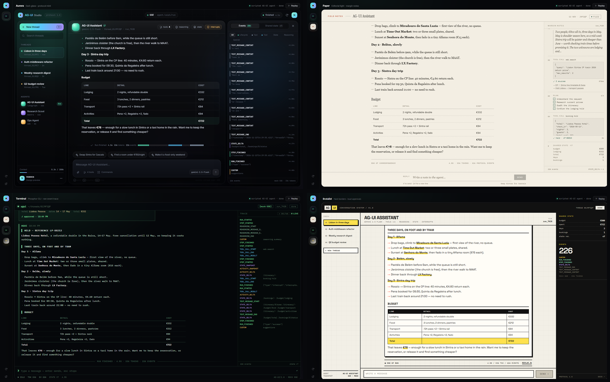

# AG-UI Studio — 对话页面设计套件

[](https://github.com/noexcs/agui-studio/actions/workflows/deploy.yml)

为 [AG-UI 协议](https://docs.ag-ui.com/introduction) 做的一套 **React 对话页面设计系统**：

> **一个协议内核 + 多种彼此独立的视觉风格（skin）**。
> 每种风格都是自包含的页面，套用时只需要换一个文件夹；接上真实 agent 时，所有风格一起生效。



## 快速开始

```bash
pnpm install
pnpm dev        # http://127.0.0.1:5178
pnpm build      # 产物在 dist/
```

URL 参数方便分享/截图：

| 参数 | 说明 |
| --- | --- |
| `?skin=aurora｜paper｜terminal｜brutalist` | 直接打开某种风格 |
| `?scene=done` | 直接渲染"已批准 + 生成完毕"的完整对话（跳过流式动画） |
| `?scene=interrupted` | 停在人工审批这一刻（展示 interrupt UI） |

快捷键：`1…5` 切换风格，`R` 重放。

## 目录结构

```
src/
├─ core/                 # 与视觉完全无关的协议层（可整体替换成 @ag-ui/client）
│  ├─ events.ts          # 事件类型、JSON Patch(RFC6902)、事件调度器
│  ├─ store.ts           # ConversationStore：事件 → 视图模型（entries/state/status）
│  ├─ context.tsx        # <ConversationProvider> + useConversation()
│  ├─ demo.ts            # 脚本化的演示 agent（唯一"编造答案"的地方）
│  └─ markdown.ts        # 轻量 markdown 渲染器
├─ shared/               # 各风格共用的小工具：Icon / Markdown / useStickToBottom
├─ skins/                # 每种风格一个文件夹，互相独立
│  ├─ registry.ts        # Skin 契约 + 注册表
│  ├─ aurora/            # 深色玻璃 · mint 渐变 · 右侧协议检查器
│  ├─ paper/             # 暖色编辑排版 · 协议细节做成"页边注"
│  ├─ terminal/          # 荧光 CLI · 右侧原始事件 trace
│  └─ brutalist/         # 硬边框 · 大字号 · 高亮的审批按钮
└─ app/                  # 工作室外壳（风格切换、场景参数）
```

## 核心契约

每种风格只做一件事：把 `useConversation()` 返回的视图模型画出来。

```tsx
// src/skins/registry.ts
export interface Skin {
  id: string;
  name: string;
  tagline: string;
  swatch: [bg, surface, accent];   // 左侧切换器上的小色块
  ChatPage: React.ComponentType;   // 必须能在 <ConversationProvider> 内渲染
}
```

```tsx
// 任何 skin 内部
const c = useConversation();
c.entries   // 有序的对话条目：user / assistant / reasoning / tool / plan / interrupt
c.sharedState, c.stateVersion   // STATE_SNAPSHOT / STATE_DELTA 之后的共享状态
c.events    // 原始事件日志（给"协议检查器"类界面用）
c.status    // idle | running | interrupted | done | stopped | error
c.send(text) · c.resolveInterrupt(approved, editedArgs?) · c.replay() · c.stop()
```

协议事件由 `ConversationStore` 归约成条目，**skin 不解析任何协议事件**，
所以换后端、换传输层、换风格三者互不影响。

### 新增一种风格（约 3 步）

1. 复制 `src/skins/paper/` → `src/skins/<your-skin>/`；
2. 改 `index.tsx` 里的返回对象（`id / name / tagline / swatch / ChatPage`）；
3. 在 `src/skins/registry.ts` 的 `skins` 数组里加一行。

CSS 按风格各自成文件，类名前缀不同即可（`.pap-` / `.bru-` …），无需构建期隔离。

## 覆盖的 AG-UI 能力

| 能力 | 用到的事件 | UI 表现 |
| --- | --- | --- |
| 生命周期 | `RUN_STARTED / RUN_FINISHED / RUN_ERROR` | 状态胶囊、run 摘要、错误块 |
| 流式文本 | `TEXT_MESSAGE_START / CONTENT / END` | 逐字输出 + 光标，markdown 实时渲染 |
| 推理 | `REASONING_*` | 可折叠"思考"面板 / 页边注 / CLI 缩进块 |
| 工具调用 | `TOOL_CALL_START / ARGS / END / RESULT` | 参数流式卡片、结果来源列表 |
| 共享状态 | `STATE_SNAPSHOT / STATE_DELTA` | 状态树、版本号、页边摘要、右侧统计 |
| 计划/活动 | `ACTIVITY_SNAPSHOT / ACTIVITY_DELTA` | 步骤清单 + 进度条 |
| 人工介入 | `RUN_FINISHED.outcome.type = "interrupt"` + `resume[]` | 审批卡（批准 / 拒绝 / 带修改批准） |
| 历史同步 | `MESSAGES_SNAPSHOT` | 断线/切换历史线程时重建完整对话（含工具调用与结果） |
| 增量 chunk | `TEXT_MESSAGE_CHUNK` / `TOOL_CALL_CHUNK` | 无 START 也能合并进消息与工具参数 |
| 工具失败 | `TOOL_CALL_RESULT` 的 `error` | 参数错误 / 内容中的 error 都会显示为失败态 |
| 并行中断 | `RUN_FINISHED.outcome.interrupts[]` | 多张审批卡；全部处理后才提交 resume[] |
| 中断约束 | `expiresAt` / `responseSchema` | 过期不提交、required/类型不匹配拒绝 resume |
| 自定义 | `CUSTOM` | 后续建议 chips、推理摘要 |

## 接真实 agent

`src/core/demo.ts` 是唯一的假数据来源。接后端时把它换掉即可：

```ts
import { HttpAgentTransport } from "./core/transport";

const transport = new HttpAgentTransport({ url: "https://your-agent/run" });
for await (const event of transport.run({ threadId, runId, messages, state, tools })) {
  store.dispatch(event);
}
```

`HttpAgentTransport` 已实现 POST + SSE 的 `BaseEvent` 流解析，形状见
`src/core/demo.ts` 生成的演示事件。`ConversationStore` 对来源完全无知：
把 `dispatch(event)` 接到真实流上，五套皮肤会同时变成生产界面。

## 设计说明

四套风格刻意覆盖不同的产品语境，共用同一份内容（里斯本三日行程 + 酒店预订审批）：

- **Aurora** — 深色玻璃拟态、mint→cyan→violet 渐变、极光背景；右侧常驻协议检查器（事件流 / 状态树）。适合"开发者工具 + 产品"混合语境。参考自书签里的 reactbits / originkit 动效与 21st.dev 组件质感。
- **Paper** — 暖纸色、Georgia 正文 + Instrument Serif 标题、首字下沉；把推理、工具、计划做成**页边注**，对话正文只留"信件"。适合研究、写作、顾问型 agent。参考 landdding / designbookmark 的编辑排版。
- **Terminal** — 荧光绿等宽 CLI、扫描线、ASCII 分隔；右侧是实时事件 trace（可切换是否显示 delta）。适合调试与工程用户。参考 scrolltide / sceneai 的"提示词即界面"气质。
- **Brutalist** — 2px 硬边框、硬投影、高饱和黄；审批做成醒目的黄色单据，按钮是"盖章"式操作。适合需要强确认的高风险操作（付款、提交、发布）。参考 brutalist 落地页与 21st.dev 的原始组件。

## 已知取舍（这是设计稿，不是产品）

- agent 回复是脚本化的（`core/demo.ts`），在输入框发送会重放同一段演示；
- `interrupt` 的"带修改批准"直接提交 `editedArgs`，未做 `responseSchema` 校验；
- 没有做路由、持久化、鉴权、i18n；
- 各风格只覆盖 1440–1600 宽度的桌面视图（窄屏做了基本降级）。

---

## 接入 pi（earendil-works/pi）

五套皮肤已经可以直接跑在 **pi** 上：`server/bridge.mjs` 起一个本地桥，
把 `pi --mode rpc` 的 JSONL 事件流翻译成 AG-UI 事件（`server/pi-map.mjs`），
再以 SSE 推给浏览器。皮肤侧只认识 AG-UI。

```bash
node server/bridge.mjs        # http://127.0.0.1:5179
pnpm dev                      # 然后点顶栏的 pi / rec
```

| 顶栏按钮 | 行为 |
| --- | --- |
| `mock` | 内置脚本 agent（默认，无需任何依赖） |
| `pi` | 真实 pi：`pi --mode rpc --no-session`，需要 pi 已登录/配置好模型 |
| `rec` | 录制的 pi 会话（`server/fixtures/pi-run.jsonl`），走同一条映射链路，离线可演示 |

URL：`?backend=fixture&instant=1`（瞬时回放，适合截图）、`?backend=pi`（直连真实 pi）。
桥的端口/路径可用 `?bridge=http://…` 覆盖。

**映射关系**（`server/pi-map.mjs`）：

| pi 事件 | AG-UI 事件 |
| --- | --- |
| `agent_start` / `agent_settled` | `RUN_STARTED` / `RUN_FINISHED` |
| `message_update.assistantMessageEvent.text_*` | `TEXT_MESSAGE_START / CONTENT / END` |
| `…thinking_*` | `REASONING_*` |
| `…toolcall_*` | `TOOL_CALL_START / ARGS / END` |
| `tool_execution_start / end` | `STEP_STARTED` + `TOOL_CALL_RESULT` |
| `get_state` 响应 | `STATE_SNAPSHOT`（agent / model / tools / cwd / usage） |
| `auto_retry_*`、`compaction_*`、`extension_error` | `CUSTOM` |

> 注意：pi 自身**没有**内建权限系统，所以 pi 模式下不会出现 HITL 审批卡
> （interrupt 仍保留给带审批的 AG-UI 后端）。如需审批，可在宿主层拦截
> `tool_execution_start` 再合成 `RUN_FINISHED.outcome=interrupt`。

## 用了多少现成组件（第三方审计）

先说结论：**第一版的 UI 组件全部是手写的，没有直接使用书签里的任何一个组件库**。
书签里的 React Bits / 21st.dev / Originkit / Aura / Landdding 等只作为视觉参考（动效、质感、排版方向），
代码里没有引入它们的组件或代码片段。查过网络请求后可以确认：运行时只加载了 Google Fonts（Inter / JetBrains Mono / IBM Plex Mono / Space Grotesk / Instrument Serif）。

之后按「功能组件能用现成的就用现成的」做了替换：

| 能力 | 之前 | 现在 |
|---|---|---|
| Markdown 渲染 | 手写行解析器（曾出过半截表格死循环 bug） | `react-markdown` + `remark-gfm` |
| 图标 | 手写 SVG path 表 | `lucide-react` |
| 字体 | Google Fonts | 保留（设计的一部分） |

仍然手写的部分及原因：四套皮肤的布局与视觉（这是本项目的交付内容）、AG-UI 事件归约与状态树、
简单的 JSON 高亮、Tab/筛选等轻交互（为避免引入完整组件库的样式体系冲突）。

可以继续替换的（还没做）：`@radix-ui/*` 或 shadcn 的 Tabs/Dialog/Tooltip/Popover、
`cmdk` 的命令面板、`sonner` 的 toast、`motion` 的入场动画、`shiki` 的代码高亮。

## 模型与后端

PI 模式默认走 **DeepSeek API**（`deepseek-flash`），配置在 `~/.pi/agent/models.json`：

```json
"deepseek-api": {
  "baseUrl": "https://api.deepseek.com/v1",
  "api": "openai-completions",
  "apiKey": "sk-…",
  "models": [{ "id": "deepseek-flash" }, { "id": "deepseek-v4-pro" }]
}
```

`pi` 与桥（`server/bridge.mjs`）本身不需要改：桥只负责把 pi 的 JSONL 事件翻译成 AG-UI。

**PI 模式现在是手动的**：切到 `pi` 只清空会话并显示「空闲」，不会自动发消息；
你在输入框里发第一条消息后才会启动 `pi --mode json`。`mock` 模式仍然自动播放演示。
## 分层原则：健壮性底座 + 自由样式

```
协议/状态层   core/            自研（AG-UI 归约、JSON Patch、store）
行为层        第三方 headless  react-markdown · remark-gfm · Radix Tabs · JsonView · ErrorBoundary · lucide
样式层        skins/*.css      完全自由，四套皮肤各自成体系
```

样式层没有任何库的痕迹：Radix Tabs 只给 `data-state`，颜色/圆角/字体仍由皮肤 CSS 决定；
JsonView 只负责 JSON 的展开折叠与转义，字体大小写在皮肤样式里。这样「换皮肤」不会碰到行为层。

### 这一轮替换掉的「自研」

| 自研 | 替换为 | 净效果 |
|---|---|---|
| markdown 行解析器（约 120 行，有过死循环 bug） | `react-markdown` + `remark-gfm` | 表格/列表/链接边界情况由库处理 |
| JSON 高亮（约 40 行正则） | `react-json-view-lite` | 折叠、转义、大对象都稳 |
| Tab 切换逻辑 | `@radix-ui/react-tabs` | 键盘导航、aria、焦点管理免费得到 |
| 图标 path 表 | `lucide-react` | 统一线宽/尺寸，新增图标不用手画 |

### 健壮性措施（现在）

- 单条事件处理失败不会打断流（`try/catch` + 日志）；
- 订阅者异常互相隔离，一个渲染出错不影响其他；
- **错误边界**：任何一套皮肤抛错只替换该皮肤这一帧，外壳/其他皮肤/事件流照常可用，并提供「重试 / 复制错误」；
- 自测入口：`?crash-test=1` 会故意抛错，用来验证错误边界；
- 手写解析器已移除，之前的死循环类型问题不再存在。

### 还没换的（按需）

Radix Popover、`sonner` toast、`react-virtuoso` 虚拟列表（事件数上千时再加）、`react-hook-form`（接真实后端表单时）。

代价：bundle 从 232KB → 448KB（gzip 138KB），主要来自 react-markdown 与 lucide 全量；后续可按需导入 + 手动分包。
## 命令面板 / 对话框 / Tooltip（Radix + cmdk）

| 能力 | 库 | 接入位置 |
|---|---|---|
| ⌘K 命令面板 | `cmdk`（内置 Radix Dialog） | `src/app/CommandPalette.tsx`：切皮肤 / 切语言 / 切后端 / 重播 / 复制状态 / 打开文档 |
| 运行详情对话框 | `@radix-ui/react-dialog` | `src/app/RunDialog.tsx`：thread / run / status / events / tokens，一键复制 JSON |
| 悬浮提示 | `@radix-ui/react-tooltip` | `src/shared/Tooltip.tsx`：左侧栏、图标按钮 |
| 错误边界 | `react-error-boundary` | `src/app/App.tsx` |

这些都在工作室外壳层，皮肤完全不需要知道它们存在；视觉样式仍写在 `app.css` 的 `.cmdk-*` / `.run-dialog-*` / `.tip` 里。

- 快捷键：⌘K / Ctrl+K 打开命令面板；`1–5` 切皮肤；`R` 重播；`L` 切语言；
- 设计评审用 URL：`?palette=1` 直接打开面板，`?run-info=1` 直接打开运行详情。

### 分包

`vite.config.ts` 用 `manualChunks` 拆成 react / markdown / radix / icons 四个 vendor chunk，
打包不再有 >500KB 的单文件警告（radix 227KB、markdown 167KB、app 115KB、icons 23KB）。
## 外壳重设计（Halden 风格参考）

外层界面按一份 "Halden" 旅行品牌的 hero 规范重做。**只借用视觉与交互语言，业务内容仍是工作室**：
没有变成旅行网站，导航菜单里是皮肤 / 智能体 / 视图，不是目的地。

| 参考元素 | 落地方式 |
|---|---|
| 全屏 hero 背景 + 上下渐变遮罩 | `/media/hero.jpg`（参考图下载后压缩到 186KB），`heroIn` 缓慢拉近 |
| Geist 400/500、深色玻璃面板、白色胶囊 CTA | `src/shell/shell.css` 全套 token（`--ink` / `--panel` / `--line` / `--ease` / `--morph`） |
| Header：logo + 居中导航 + actions | 三段 grid；入场动画 `fadeDown` / `fadeIn`（nav 只动 opacity，避免影响 dropdown 定位） |
| **Morphing dropdown**（签名交互） | `src/app/MorphNav.tsx`：一个共享容器 morph x/w/h，面板滑入 + blur 交叉淡出；首次打开 `instant/snap`，指针切换 56px 方向位移 |
| 三个内容面板 | 皮肤（列表 + 截图预览交叉淡入）· 智能体（两张图卡：演示 / pi 实时）· 视图（语言 / 重播 / 运行详情 / 文档） |
| 移动端 sheet | 同一套玻璃面板，分组链接；`≤860px` 显示菜单按钮，桌面显式隐藏 |
| reduced motion | `--morph: 0.01s`，关闭模糊与动画 |

功能仍然全部在：⌘K 命令面板、运行详情、语言切换、双后端、URL 深链。设计评审入口新增：
`?menu=skins|agent|view` 直接展开某面板，`?sheet=1` 展开移动端面板。

注意：皮肤内部的 `.panel` 类与外壳下拉面板曾类名冲突（导致 Aurora 在 `opacity:0` 的面板里不可见），
现在外壳统一使用 `.dd-panel` 命名空间，皮肤类名不再需要避让。
## 外壳 v2：Grid Motion Hero + 全铺满工作区

上一版 Halden 式「玻璃舞台 + morph 下拉」已替换。现在的结构：

1. **首页**：全屏 Hero，背景是移植自 React Bits 的 **Grid Motion**（`src/shell/GridMotion.tsx`，MIT 源码移植、无新依赖）：
   倾斜 5 行瓦片墙缓慢漂移、鼠标视差、聚光跟随、边缘羽化遮罩；瓦片用四套皮肤的截图与两张参考图混排。
2. **Hero 下方**：四张皮肤卡（截图 / 名称 / 色点 / 一句话 / 进入）+ 一排快捷按钮（命令面板、语言、后端、运行详情、协议文档）。
3. **工作区**：选中皮肤后**直接铺满** 100svh，没有任何外框或背景图；左下角浮动 dock 负责返回首页、切换皮肤、命令面板、语言、后端、运行详情。

中文仍是全站切换；`?lang=zh`、`?skin=aurora`（直接进工作区）、`?section=skins`（首页滚动到皮肤区）、`?palette=1`、`?run-info=1` 都可分享。

> Grid Motion 的交互数学（行漂移、惯量、聚光距离场、羽化 mask）保持源码逻辑；CSS 只保留画布、行、瓦片三层。
## 外壳 v3：首页内联，不再跳转

按反馈把「皮肤选择」和「皮肤使用」合并到同一页：

- Hero（Grid Motion）下方是四枚**皮肤按钮**（编号 / 名称 / 色点 / 一句话）；
- 按钮正下方就是当前皮肤的**实时界面**：直接交互、直接跑对话，切换按钮只替换这一块，不跳页；
- 同一份 store、同一段对话在四套皮肤之间共享，所以切换时状态不丢；
- 工具条提供：后端切换、语言、运行详情、**全屏打开**（`?full=1` 保留原来的独立工作区 + dock，用于长时间使用）。

URL：`?skin=paper` 直接选中并内联展示；`?section=skins` 定位到按钮区；`?full=1` 全屏；`?lang=zh` 中文。
## 第五套皮肤：Classic（企业中性）

目标：放进任何后台系统都不突兀的「默认正确答案」。

- 浅灰画布 `#f7f8fa` + 白色面板 + `1px #e5e7eb` 边框，单一蓝色主色 `#2563eb`；
- 系统字体栈（Inter → -apple-system / Segoe UI / PingFang SC / 微软雅黑）；
- 三栏布局：对话列表（244）· 对话主区 · 会话详情（300：运行信息 / 计划 / 共享状态 / 待处理）；
- 标准组件：消息行 + 头像、工具调用折叠卡、思考过程折叠、计划清单、审批卡（琥珀色警示条 + 主按钮 / 次按钮 / 修改条款）；
- 状态用语义色（进行中蓝 / 待确认琥珀 / 已完成绿 / 出错红），全部带文字，不只靠颜色；
- 响应式：≤1280 收起详情栏，≤860 收起左侧列表。

它是唯一浅色、唯一系统字体的皮肤，也是唯一默认三栏带「待处理」清单的皮肤。
## 皮肤工具包：移植指南

皮肤不再是「依赖整个 App 的组件」，而是通过一个公开契约接入：

```tsx
import { SkinHostProvider } from "./skin-kit";
import { ClassicPage } from "./skins/classic";

<SkinHostProvider
  conversation={model}                 // 任何实现 SkinConversation 的对象
  lang="zh"                            // "en" | "zh"
  branding={{ agentName: "Acme Copilot", modelLabel: "gpt-4.1" }}
  messages={{ "chat.send": "提交" }}     // 可选：文案覆盖
>
  <ClassicPage />
</SkinHostProvider>
```

### 宿主必须提供什么

`SkinConversation`（`src/skin-kit/contract.ts`）——皮肤只读这些，不需要知道 AG-UI：

| 分类 | 成员 |
|---|---|
| 状态 | `entries` `sharedState` `stateVersion` `touchedPaths` `events` `status` `suggestions` `threadId` `runId` `tokens` `transport` |
| 读取 | `getVersion()` `duration()` |
| 动作 | `send()` `stop()` `replay()` `resolveInterrupt()` |
| 订阅 | `getVersion()` + `subscribe(listener)` —— **流式输出靠它触发重绘**；宿主不提供则皮肤不会实时更新 |

### 皮肤拿到什么

- `useSkinConversation()` — 上面的模型；
- `useSkinBranding()` — `agentName` / `modelLabel` / `workspaceName` / `threadTitle`；
- `useSkinLang()` / `useSkinT()` — 语言与字典（provider 会把当前语言与覆盖项钉在字典层）；
- 兼容层：皮肤内部仍可用 `useConversation()`（等价于 conversation），所以老皮肤无需改数据读取方式。

### 已验证

`?full=1&skin=classic&agent=Tripilot&model=gpt-4.1` 可在不改一行代码的情况下，
把 Classic 皮肤的品牌名与模型名换成 `Tripilot / gpt-4.1`。

### 迁移一个文件夹到别的系统

1. 拷贝 `src/skin-kit/` + `src/skins/<skin>/` + `src/shared/{Markdown,Icon,useStickToBottom}` + `src/i18n/`；
2. 安装 `react-markdown remark-gfm lucide-react`（Aurora 另需 Radix Tabs + react-json-view-lite）；
3. 把宿主数据包成 `SkinConversation`，用 `SkinHostProvider` 包住 `<SkinPage />`；
4. 宿主需要自行加载字体（Geist / JetBrains Mono / IBM Plex Mono / Space Grotesk / Instrument Serif）。

### 还没做（下一步）

- 抽成可发布的 `agui-skins` 包（exports map / peerDeps / 版本化）；
- 每套皮肤一个 Storybook story + 用固定事件流渲染的契约测试；
- 多实例、多语言同页并存（目前字典是「当前宿主」单例）。
## 可发布包：`packages/agui-skins`

皮肤与工具层已经抽成独立的 workspace 包，应用改为消费方。

```
packages/agui-skins/
├─ package.json          # name: agui-skins, exports map, peerDependencies
└─ src/
   ├─ index.ts           # SkinHostProvider / hooks / skins / Icon / Markdown / i18n
   ├─ contract.ts        # SkinConversation · SkinBranding · SkinDefinition · Entry 类型
   ├─ host.tsx           # 唯一的集成点
   ├─ utils.ts           # formatDuration · plainText · estimateTokens
   ├─ shared/            # Icon · Markdown · useStickToBottom
   ├─ i18n/              # 中英字典（provider 可覆盖单键）
   └─ skins/             # aurora · paper · terminal · brutalist · classic
```

应用侧通过 workspace 依赖消费：`"agui-skins": "workspace:*"`，
旧的 `src/i18n`、`src/shared` 只剩一行转发（re-export），`src/skins`、`src/skin-kit` 已删除。

### 作为 npm 包使用（宿主视角）

```bash
npm i agui-skins react react-dom react-markdown remark-gfm lucide-react
# Aurora 可选：@radix-ui/react-tabs react-json-view-lite
```

```tsx
import { SkinHostProvider, skins, Icon } from "agui-skins";
import "agui-skins/index.css"; // 皮肤样式随包分发，需显式引入

const Page = skins.find((s) => s.id === "classic")!.ChatPage;

<SkinHostProvider
  conversation={model}          // 实现 SkinConversation 即可
  lang="zh"
  branding={{ agentName: "Acme Copilot", modelLabel: "gpt-4.1" }}
>
  <Page />
</SkinHostProvider>
```

### 契约测试（fixture）

`tests/fixture.ts` 构造一份覆盖全部 entry 类型（user / reasoning / tool / plan / interrupt / assistant）的会话，
`tests/skins.test.tsx` 对 **每套皮肤** 断言：

- 六类条目都能渲染（用户消息、回答、工具名、计划步骤、审批文案）；
- 注入的 `branding.agentName` 出现在界面上；
- `messages` 字典覆盖生效（如把「发送」改成任何文案）；
- 未套 `<SkinHostProvider>` 时抛错（契约边界有效）。

```bash
pnpm test
# Test Files  2 passed (2)
# Tests       68 passed (68)
```

### 发布状态

- `exports` 已指向 `dist/`（tsup 构建：主入口 + i18n + contract + 5 皮肤子入口，js + d.ts + 稳定命名 CSS）；
- `npm pack` 已在独立 Vite + React 18 项目安装实测通过（含 `tsc --noEmit` 零错误与 i18n 单例验证）；
- CSS 随包分发：消费方显式 `import "agui-skins/index.css"`（整包）或按皮肤 `agui-skins/skins/paper.css`；
- 后续：包 README、changesets 版本管理、Storybook。

## 协议覆盖现状（P0 已补）

- ✅ 消息快照、chunk 合并、工具错误态；
- ✅ 并行中断：每张卡独立 pending，全部解决后才一次性提交 `resume[]`，`lastResume` 可在测试中检查；
- ✅ 过期中断：`expiresAt` 到期后不提交 resume，标记 `expired`；
- ✅ schema 校验：`responseSchema.required` 与 boolean/string/number/object 类型不匹配时拒绝并提示；
- ⏳ 仍缺（P1/P2）：capabilities 发现、子 agent 事件、`REASONING_ENCRYPTED_VALUE`、`RAW`、二进制/WebSocket 传输、activityType 可插拔渲染。

新增 `tests/protocol.test.ts`：覆盖快照重建、chunk 合并、工具失败、并行中断、schema 拒绝、过期中断；
`pnpm test` 现在共 **256 个用例（16 个文件）**。


## P1 已补（协议表达力）

- **capabilities 驱动能力标签**：Aurora 顶部 chips 与 Classic 右侧「能力」面板都来自 `conversation.capabilities`，不再硬编码；
- **子 agent 事件**：`SUBAGENT_STARTED / FINISHED / ERROR` 映射为 `subagent` entry；Aurora/Terminal 渲染在对话流里，Classic 有独立样式，Paper/Brutalist 忽略不报错；
- **activityType 可插拔**：`PlanEntry` 保留原始 `content`；非 PLAN 类型（如 SEARCH）在 Aurora/Classic 里回退为原始 JSON 展示，而不是只显示空步骤；
- **加密推理**：`REASONING_ENCRYPTED_VALUE` 挂到 reasoning entry 的 `encryptedValue`，Aurora 在思考面板标注 `encrypted`；
- **多中断按卡定位**：五套皮肤的批准/拒绝/修改按钮现在都传 `entry.id`，可以跳着处理并行审批卡。

契约同步新增：`SkinCapabilities`、`SubagentEntry`、`PlanEntry.content`、`ReasoningEntry.encryptedValue`。

剩余 P2：`RAW`/metadata 的可视化、二进制与 WebSocket 传输、历史分支切换、Storybook。


## 验证体系（P0 已完成）

| 层 | 现在的做法 | 状态 |
|---|---|---|
| L1 事件矩阵 | `tests/event-matrix.test.ts`：30 个声明事件逐一派发（最小 payload），另有顺序/重复/未知事件用例 | ✅ 30/30 |
| L1 顺序与幂等 | CONTENT 先于 START、重复 START、重复 RUN_FINISHED、二次 resolve、未知 tool id、未知 activity、CUSTOM usage | ✅ |
| L1 状态机 | idle → running → done、RUN_ERROR 落 error entry | ✅ |
| L3 端到端 | `tests/fixture.ts` 改为「派发真实事件 → ConversationStore → 皮肤」，皮肤测试不再用手写 entries；流式重绘测试也走真实 dispatch | ✅ |
| L2 适配器 | `tests/pi-map.test.ts`（29 例）+ `tests/bridge.test.ts`（10 例，真实子进程+动态端口） | ✅ |
| L4 传输 | `tests/transport.test.ts`（12 例：CRLF、半帧/粘包、abort） | ✅ |
| L5 实时冒烟 | 真实 pi + DeepSeek（凭据开关） | ❌ 待补 |

现在 `pnpm test` 共 **256 个用例 / 16 个文件**，CI 每次推送跑测试+覆盖率门（lines ≥70%）。剩余最大的空白是 L5：
真实 pi + DeepSeek 的实时冒烟仍只有人工验证（凭据开关，P0 未含）。


## 外壳 v4 与快速上手（2026-11 换血）

首页外壳整体升级到一套 violet 设计 token 体系（参考 gradientdeck / cult-ui / reactbits 的公共语言）：

- **hero**：大标题 640 字重 + -0.04em 紧字距，标题混排衬线斜体词（en "protocol." / zh「协议」）；Grid Motion 背景改为深紫黑底 + violet 光带 + 四角暗角；
- **皮肤展示区**：卡片 mono slug + 皮肤名 + 调色板 swatch 圆点行（每套皮肤的主题色一眼可读），is-current 卡 violet 描边；
- **Customize**：elevated 大圆角容器，label mono uppercase；
- **QuickStart**：最小上手路径（安装 / 最小示例 / 接 agent 三张代码卡，跟随当前选中皮肤动态生成，highlight.js 高亮 + 一键复制）+ 皮肤一览（Copy for AI 下拉：prompt / 配置代码 / 安装命令 / Open in ChatGPT|Claude|v0）；
- 交互细节全站统一：150/250ms 两档动效、按压反馈、`prefers-reduced-motion` 兜底、focus-visible accent ring。

## 在线演示（GitHub Pages）

- 地址：https://noexcs.github.io/agui-studio/
- 部署方式：`.github/workflows/deploy.yml`（push main → build → Pages artifact）
- 构建开关：`VITE_STATIC_DEMO=1`（强制演示模式：隐藏 pi/后端切换、不请求本地 bridge）
- 子路径：`VITE_BASE=/agui-studio/`，由 workflow 按仓库名自动计算；资源通过 `import.meta.env.BASE_URL` 拼接
- 本地复现静态包：

```bash
VITE_STATIC_DEMO=1 VITE_BASE=/agui-studio/ pnpm build
npx serve dist   # 或任意静态服务器
```


## 皮肤自定义（每套皮肤独立）

首页舞台下方**默认展开**一块常驻的自定义面板（工具条「自定义」可收起）；全屏模式为 dock 抽屉。

可调项：

| 项 | 取值 | 实现 |
|---|---|---|
| 主题色 | 8 个预设 + 任意取色 | `SkinHostProvider` 注入 `--sk-accent`，`tuning.css` 按皮肤映射到各自变量（classic `--accent`、paper `--vermilion`、terminal `--green`、brutalist `--yellow`、aurora `--violet` + 渐变） |
| 文字动画 | 无 / 渐显 / 上浮 | 对 `.md` 块做出现动画（块首次挂载时播放，流式新增段落自然生效），支持 `prefers-reduced-motion` |
| 信息密度 | 宽松 / 紧凑 | 调整 markdown 行高与段落/列表/表格间距 |

- 按皮肤分别保存在 `localStorage`（`agui-studio:tuning`），刷新不丢；
- 支持分享链接：`?accent=%23db2777&anim=rise&density=compact`；
- 面板内「恢复默认」清空当前皮肤覆盖；
- 预设：原始 / 冷调 / 暖调 / 紧凑，一键套用。

实现位置：`packages/agui-skins/src/tuning.css`、`packages/agui-skins/src/host.tsx`（`tuning`/`skin` props）、`src/app/CustomizePanel.tsx`。
